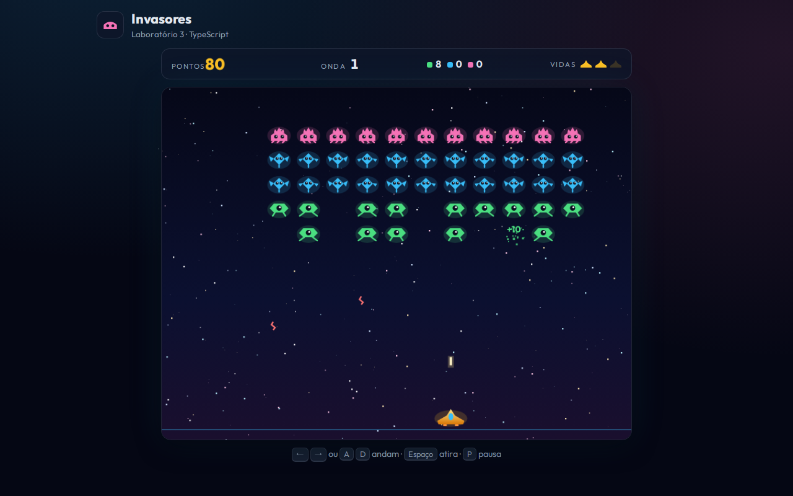

# Invasores TS



Jogo de nave contra ondas de invasores, com tiros, vidas, pontuação e estrelas piscando. Laboratório do **Use a Cabeça! C#** reescrito em **TypeScript**, com a mesma estrutura do
[corrida-cachorro-ts](https://github.com/jamangueira7/corrida-cachorro-ts): React + Vite, Fastify, Postgres com
Kysely, Vitest e tudo subindo com Docker.

> Status: estrutura pronta; o laboratório segue as semanas do `docs/cronograma.md`.

## Rodar

Pré-requisito: Docker com Compose. Não precisa de Node na máquina.

```bash
docker compose up -d          # ou: make up
```

- App: http://localhost:5175
- API (pelo proxy do Vite): http://localhost:5175/api/health
- Banco: `docker compose exec db psql -U lab`
- Produção (nginx + Node compilado): `make prod` → http://localhost:8080

## Estrutura

```
packages/domain/   classes do livro em TS puro + testes (Vitest)
apps/web/          React + Vite (testes de tela com Testing Library + jsdom)
apps/api/          Fastify + Kysely, migrations em src/migrations (testes de integração *.int.test.ts)
e2e/               Playwright (roda no Docker)
docs/cronograma.md plano dos três laboratórios
```

## Testes

```bash
make check        # lint + tipos + unitários (domínio, tela e API sem banco)
make test-int     # API contra Postgres real (banco lab_test, criado na hora)
make e2e          # Playwright no Docker, contra o app em http://web:5173
make screenshot   # joga uma partida e regrava docs/screenshot.png
```

`make e2e`, `make test-int` e `make screenshot` precisam do app no ar (`make up`). O `make check` é o que o hook de
pre-push roda; os de integração e E2E ficam de fora dele.

## Desenvolvimento

```bash
git config core.hooksPath .githooks   # ativa os hooks de commit e push
make check                            # ESLint + tsc + Vitest no container
```

Branches `feature/<nome>`, commits `tipo(escopo): descrição` com até 6 arquivos. Detalhes na skill
`.claude/skills/lab-ts/SKILL.md`.
